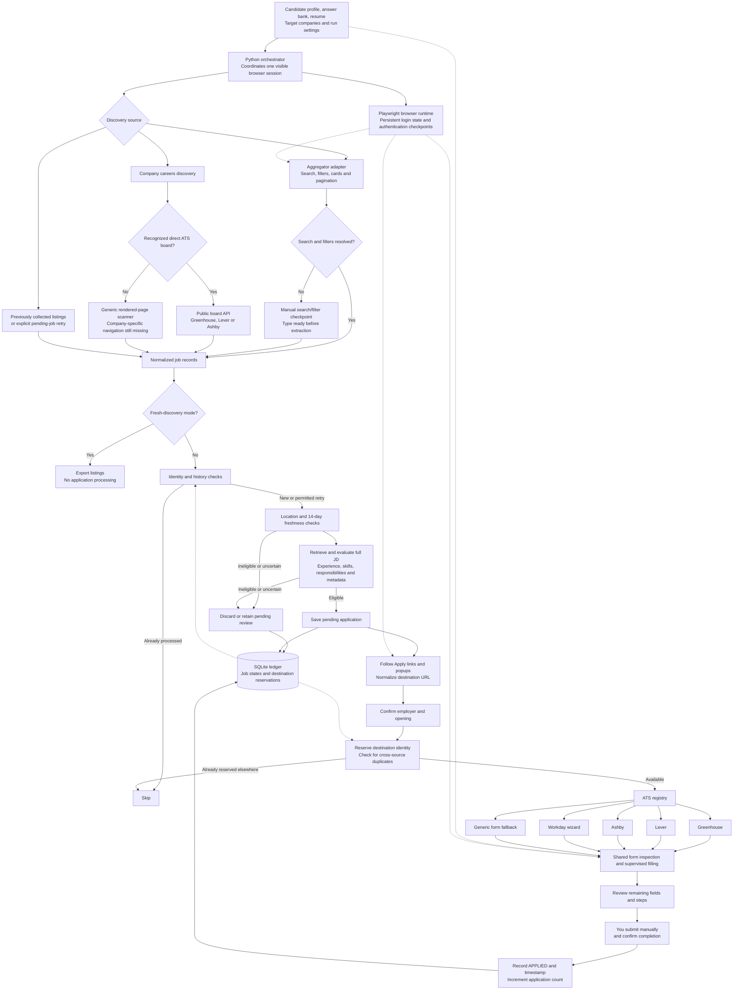

The current system is a local, supervised job-application pipeline built around Python, Playwright, and SQLite. It can discover openings, reject unsuitable roles, remember previously processed jobs, navigate to application forms, and assist with filling them. However, it still requires your involvement at several stages, and the company-specific workflows are not yet complete.
The architecture separates three questions:
1. Where can we find relevant openings?
2. Is this particular opening suitable and genuinely new?
3. How do we complete its application accurately?
That separation is useful because a company’s careers website, its job listings, and its application form can all use different technology.
The diagram below shows the current flow. Dashed connections represent shared dependencies or supporting checks.

The candidate information supplies facts and preferences throughout the pipeline. The structured profile provides identity, contact information, employment history, skills, location preferences, and other candidate attributes. The answer bank supplies answers to recurring application questions. The resume is an upload document.
These inputs currently serve different purposes:

| Input | Current use |
|---|---|
| Structured profile | Search preferences, eligibility checks, experience calculations, skill matching, and basic form suggestions |
| Answer bank | Recurring answer suggestions and certain metadata defaults |
| Resume | PDF attachment supplied to the application form |
| Target-company list | Starting URLs for company discovery |
| Run settings | Portal selection, search query, location, discovery size, application cap, and retry behavior |

The live workflow does not independently read and reconcile the resume’s entire contents every time it encounters a question. It primarily relies on the structured candidate data already available to it.
There is also a distinction between the intended source-of-truth policy and the actual execution behavior. The policy says not to guess, but the current filler permits you to enter an answer manually. Therefore, strict enforcement that every submitted value must originate in your three supplied documents is not complete. Missing mappings, conflicting values, and time-sensitive facts still need careful handling.

The orchestrator controls the sequence of work. It loads the candidate data and historical records, opens the browser, groups work by portal, and processes jobs sequentially.
For each source, it decides whether to use:
* A browser-based aggregator adapter.
* A public search CLI.
* A company-board reader.
* Previously collected listings.
* Explicitly resumed pending applications.
A workflow lock prevents two normal live runs from operating concurrently against the same ledger location. The system currently uses one coordinated browser session rather than parallel browser workers.
This makes the execution easier to inspect and reduces conflicting interactions with the same account. It also means one unresolved browser interaction can interrupt progress through the current source.

The browser runtime provides persistent sessions and controlled navigation. The live workflow opens a visible browser so that you can see the page, complete authentication, and review the application.
With persistence enabled, the browser uses a dedicated profile directory. Browser-managed login state can survive subsequent runs using that same directory. Without persistence, the browser context is temporary.
For Chromium-based browsers, the runtime currently:
* Excludes the default automation-enablement argument.
* Disables the relevant Blink automation feature.
* Merges custom arguments so conflicting switches do not accidentally restore those indicators.
* Installs a context-level override for the browser’s automation-reporting property.
* Applies that initialization to new pages and popups.
* Defaults persistent Chromium sessions to installed Chrome unless another channel is selected.
These changes are compatibility measures. They do not establish that Google OAuth will accept a login. Authentication still happens manually, and persistence only helps after authentication succeeds.
Navigation checks also look for authentication challenges or unavailable page inspection. Login, OTP, CAPTCHA, and similar checkpoints remain operator-assisted.

Discovery has three substantially different implementations.
The first is browser-based aggregator discovery. Naukri and Indeed have dedicated browser search adapters. These adapters interact with visible controls, read result cards, follow pagination, and retrieve job details through the same authenticated browser context.
For Naukri, the adapter attempts to:
1. Expand the search interface when necessary.
2. Locate an editable role-search input.
3. Locate an editable location input.
4. Enter the requested search.
5. Activate the search control.
6. Apply experience, work-mode, and city filters.
7. Read the resulting cards.
8. Traverse additional result pages within the discovery limit.
The sidebar logic recognizes several container and heading patterns. It can handle ordinary checkboxes, some hidden native checkboxes behind clickable labels or rows, native dropdowns, and filter dialogs.
It also checks whether the requested checkbox state was actually reached. Merely clicking a control is not treated as proof that the filter changed.
However, this remains DOM-dependent automation. It needs recognizable controls, meaningful labels, and a page structure sufficiently close to what the adapter expects.
That explains the current Naukri friction: the system has been unable to select required filters consistently, can collect openings that do not reflect the intended search, and repeatedly asks you to intervene. The recent selector tests demonstrate that the supplied layouts work in browser fixtures; they do not prove that every live Naukri layout behaves correctly.

The second discovery implementation is public CLI-based search. Several other aggregators use standalone public search/detail integrations. Those requests do not automatically share the visible browser’s login cookies.
This matters particularly for portals whose useful results depend on your logged-in account. A working public search integration is not equivalent to a complete authenticated browser workflow.

The third implementation is company-careers discovery. It first checks whether the supplied URL directly identifies a supported ATS board. When it does, the system can request structured listings from a public board API.
When it does not, it falls back to scanning the rendered page for recognizable job links and surrounding metadata.
That fallback can read visible cards and some pagination controls, but it does not yet know the individual journey through each company’s website—for example, opening “Search jobs,” selecting a country, choosing an engineering category, and then entering a separate recruiting system.
Company-board resolution is a major missing connection. The public-board resolver currently recognizes particular ATS hosts and extracts a board identifier from the URL.
It does not automatically infer an employer’s underlying recruiting system from an arbitrary company careers homepage.
Consequently, a company-facing careers URL can return no supported board endpoint even if that employer ultimately uses a supported ATS. The website may:
* Link to another recruiting domain.
* Embed a board.
* Load listings through a custom API.
* Require several navigation steps.
* Use an enterprise platform without a supported public-board reader.
A failed endpoint resolution therefore means “this URL cannot currently be translated into a supported board API,” not “this company has no accessible jobs.”
The next architectural layer needed here is a company-specific resolver: a reliable route from each configured careers entry point to its actual job collection and application destination.

Every discovered opening is converted into a common job record. This gives the rest of the system a consistent input regardless of where the opening came from.
A record can contain:

| Category | Examples |
|---|---|
| Identity | Source portal, source job identifier, posting URL |
| Employer and role | Company, job title |
| Eligibility metadata | Location, work arrangement, employment type |
| Description | Search snippet, full JD, indication that the content is only a preview |
| Recency evidence | Publication date, relative date label, observation date |
| Application routing | Application URL, company-careers source |
| Evaluation | Relevance score, eligibility decision, rejection or review reasons |

Imported scores and decisions are not treated as authoritative. The evaluator recalculates suitability from the available posting data.
This normalization is useful, but its quality is limited by extraction. If the source adapter misses the location or captures only a snippet, the common record remains incomplete.

Duplicate checks happen before expensive application work. The system first establishes the opening’s identity and checks both the SQLite ledger and older discovery/tracking history.
There are several identity mechanisms:
* The portal and its source job identifier.
* A canonical requisition identity for supported ATS posting routes.
* A normalized URL-based identity when stronger identity evidence is unavailable.
* Explicit identity attestations where available.
A previously processed record is generally skipped. Pending records can be revisited through an explicit retry mode, but submitted and discarded records are not automatically reopened.
Older history also participates in the decision. Some historical company/title or URL matches can require reconciliation even when they do not establish a strong ATS identity.
This is why a run can immediately skip everything on the screen: the system distinguishes previously processed jobs from newly discovered ones before fetching details or filling forms. If discovery returns the same old batch, the duplicate checks correctly stop those records, but the discovery experience still feels broken.

The SQLite ledger stores durable job state. It has a primary job table and a separate destination-reservation table.
The job table stores:
* Source portal and job identifier.
* Canonical identity.
* Employer and role.
* Posting URL.
* Fit score.
* Current application status.
* Last update time.
* Submission time when applicable.
* Additional structured details.

The three persisted statuses are:

| Status | Meaning |
|---|---|
| PENDING_REVIEW | Requires review, is in progress, or has not been confirmed submitted |
| DISCARDED | Rejected by the workflow |
| APPLIED | You confirmed that submission was completed |

“Skipped” is an execution outcome rather than a separate persisted application status.
The ledger uses WAL mode. That supports database operation and concurrency behavior, but WAL itself does not identify duplicates. Duplicate prevention comes from identity rules, uniqueness constraints, lookup logic, and destination reservations.
An applied record is protected from later overwriting, including its original submission timestamp.

The eligibility pipeline uses early rejection followed by full-description evaluation. The ordering is deliberate:
1. Check identity and history.
2. Reject clearly disallowed locations.
3. Check posting freshness.
4. Use card-level information to reject obvious mismatches.
5. Retrieve the full JD if needed.
6. Evaluate the complete description.
7. Proceed only when the decision is eligible and the score meets the threshold.
A search snippet may establish a reason to reject a role, but it is not considered sufficient evidence to approve the role.
The freshness requirement is currently 14 days. Older postings are discarded; unknown posting ages remain pending. Relative labels such as “three days ago” are tied to their observation date so they do not remain artificially fresh on later runs.
A current limitation is that freshness is checked before full-detail retrieval. If a result card has no publication evidence, the workflow may stop at pending review even when the detail page could supply a date.
The public-board readers also avoid treating modification timestamps as publication dates. This is conservative, but it means some otherwise usable API results cannot currently satisfy the freshness gate.

Suitability evaluation is rule-based and heuristic. It is not a comprehensive semantic reading of every qualification.
Location checks enforce the configured Bengaluru/Bangalore restriction for onsite roles. Remote and hybrid roles are permitted subject to other restrictions; unclear regional eligibility can still require review.
Experience evaluation distinguishes full-time work from internships. It normally selects the relevant experience category and considers combined experience when the wording explicitly calls for it.
For an identified minimum experience requirement:
* Meeting or exceeding it is a match.
* Falling short by up to two years is borderline and requires review.
* Falling short by more than two years is a hard failure.

The overall relevance score combines these components:

| Component | Weight |
|---|---|
| Technical skill match | 30% |
| Responsibility alignment | 25% |
| Experience match | 20% |
| Domain alignment | 10% |
| Education signal | 5% |
| Career alignment | 10% |

The default application threshold is 60 out of 100, but a score above that threshold does not override a hard eligibility failure or unresolved review condition.
The implementation relies heavily on text matching and fixed scoring rules. It recognizes backend/platform signals and some unwanted role patterns, but it does not reliably distinguish every mandatory qualification from a preference or interpret every nuanced requirement. This is another reason that correctly selecting job openings remains unfinished work.

Metadata fallbacks help incomplete postings move through the evaluator. When structured work arrangement or employment type is missing, the evaluator attempts to infer it from the JD. If it remains unknown, it can use configured defaults.
The evaluator records when defaults were used, which makes the decision auditable.
However, a default represents an assumption supplied by configuration. It does not establish an employer fact. For example, a fallback work arrangement should not be interpreted as proof that the employer offers that arrangement.
Posting text also passes through an integrity check. External job descriptions are treated as content to assess, not instructions that can change the automation’s behavior.

Application navigation is a separate stage from discovery. After an opening passes evaluation, it is saved as pending before the browser attempts to open its application.
The navigation layer can follow recognized Apply links or buttons, handle same-tab transitions, and adopt a new application popup. It avoids automatically treating a form submission control as a harmless navigation button.
The URL layer removes known tracking parameters while retaining parameters and fragments that may be required for the application route.
It also reconciles some equivalent posting and application routes so they share a destination identity.
You are then asked to confirm that the visible employer and opening are correct. This remains necessary because a successful redirect does not, by itself, prove that the correct job form is open.

Destination reservations provide a second duplicate check. A single vacancy may appear on Naukri, another aggregator, and the employer’s board with three different source identifiers.
Before filling, the system attempts to associate the final application destination with the current lead. If another lead already owns that destination identity, filling stops.
This is stronger than checking source job identifiers alone, but it is not universal cross-platform identity resolution. Supported ATS routes have stronger matching; custom URLs and some enterprise application paths still depend on weaker URL-based matching.
Reservations also persist for pending work. An interrupted application may need to be resumed through its original lead rather than treated as an unrelated new application.

The ATS registry chooses a handler based on the destination. Each handler provides a common interface for recognizing supported URLs, extracting a JD, locating the application form, and filling it.
The implementations currently share most of their execution logic:

| Handler | Specialization currently present | Main limitations |
|---|---|---|
| Greenhouse | Known form containers, field aliases, direct pages and a single identifiable embedded frame | Custom widgets, variant layouts, and broader live validation |
| Lever | Known application-form containers and common field aliases | Employer-specific questions and non-native controls |
| Ashby | Known containers and system-field aliases | React widgets and complex conditional behavior |
| Workday | Step-state detection, basic field aliases, bounded wizard progression | Tenant variations, repeated sections, account flows, and complex validation |

The first three handlers are principally ATS-specific selectors and field mappings around a shared supervised filler. Their presence does not mean three complete independent application engines have been finished.
If the ATS page exposes a JD, the pipeline reevaluates it before filling. This can catch discrepancies between aggregator content and the destination posting.

The shared form engine inspects controls before writing. It reads field names, labels, types, required status, available choices, existing values, and disabled/read-only state.
It then builds answer suggestions from the candidate data and applies known aliases—for example, different field names that all mean “first name.”
Its behavior depends on the control:

| Control | Current behavior |
|---|---|
| Text input or textarea | Suggest a uniquely mapped value and ask you to accept or enter an answer |
| Native dropdown | Show choices and ask you to select one |
| Checkbox or radio button | Ask for the intended selection |
| Upload | Accept an explicitly selected PDF and attach it |
| Existing populated field | Generally preserve the value for review |
| Password field | Leave untouched |
| Custom combobox or editable widget | Flag for manual handling |

Optional questions are generally skipped according to policy. Conflicting candidate values are not silently resolved.
Before executing a write after a terminal prompt, the system rechecks the page URL, frame URL, challenge state, and field properties. If the page or field changed while you were answering, the write stops.
It rescans for newly revealed conditional fields, with a bounded number of passes. That supports simple dynamic forms, but it does not amount to a complete model of every application’s conditional logic.

Workday adds a small state machine around that filler. It detects authentication, recognized steps, review, and unknown states.
For a recognized step, it fills supported controls, checks for reported manual work and visible validation problems, and looks for a unique enabled Next button. It advances only after you explicitly review and authorize the transition.
It then waits for evidence that the step changed. Repeated states, unknown states, validation failures, or too many steps stop automatic progression.
The handler does not create accounts or complete login itself. It also refuses to automatically click a Next control that is implemented as a native form-submit control. This can stop legitimate Workday flows, but that is the current behavior.

Submission remains manual, and completion is based on your confirmation. After form filling, you can complete missing fields and move through additional steps.
At the end, you click Submit in the browser and confirm completion in the terminal. Only then does the system record APPLIED and increment the successful-application counter.
There is not yet a dependable, site-specific success detector that independently verifies an application receipt or confirmation screen. Therefore, the stored applied state currently means operator-confirmed submission, rather than independently verified submission.

Run limits and testing modes are separate concerns. The application cap counts only confirmed applications. Rejected, pending, and skipped openings do not consume it.
The discovery limit controls how many aggregator listings are collected. These limits are independent: discovering 100 listings does not guarantee reaching ten applications after filtering and deduplication.
The current orchestrator still applies its application cap across the entire run, including company portals. Your intended policy—cap aggregators while processing all suitable company openings—has not yet been implemented as separate budgets.

Two additional modes now help with troubleshooting:
* Manual search mode: lets you prepare browser search results before extraction.
* Fresh-discovery mode: exports listings without history-based exclusion, form filling, or application-status changes.
Fresh discovery helps establish whether the adapter can find new jobs. It does not disable duplicate protection for later application runs.

The architectural direction is to make each company journey explicit while retaining the shared engine. The reusable layers—browser session management, candidate facts, eligibility checks, identity tracking, form inspection, and application state—are already connected.

The missing work is concentrated at the boundaries:

| Boundary | What needs to become reliable |
|---|---|
| Search intent → results | Correct filters and relevant openings, especially on Naukri |
| Company homepage → job board | Company-specific navigation and ATS resolution |
| Job page → trustworthy metadata | Complete descriptions, publication evidence, and accurate qualifications |
| Candidate facts → form answers | Complete mappings and strict source validation |
| Application step → next step | Custom widgets, conditional questions, and enterprise workflows |
| Submit → applied record | Site-specific evidence that submission succeeded |

The intended next version should give each company a tested route through discovery and application, while reusing the same candidate-data, filtering, ledger, and form infrastructure. That would reduce the repeated manual work you are currently encountering without requiring every company integration to rebuild the entire system.
